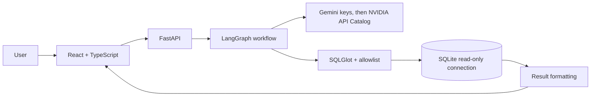
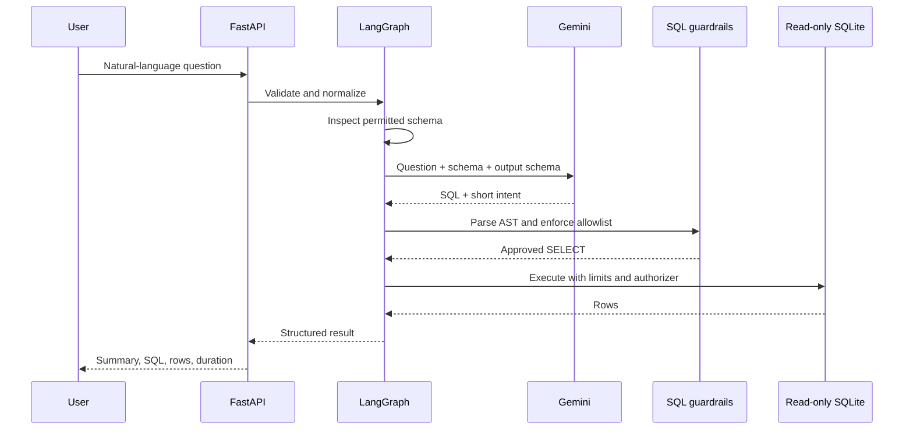

# QueryPilot

QueryPilot is a small text-to-SQL analytics demo for business users. Ask a question about a deterministic retail dataset, inspect the generated SQL, and review the returned rows. SQL goes through parser checks and SQLite execution restrictions before it can run.

## Features

- FastAPI API with `/health`, `/api/schema`, `/api/query`, `/api/history`, Swagger at `/docs`, and OpenAPI at `/openapi.json`.
- Gemini structured output through LangChain with NVIDIA API Catalog chat-completion fallback, orchestrated by an explicit LangGraph workflow.
- SQLGlot validation, an explicit table and column allowlist, SQLite URI read-only mode, SQLite authorizer, execution timeout, and result row cap.
- Synthetic customers, products, orders, and order items; database can be recreated with `python -m scripts.seed`.
- React and TypeScript UI with example questions, schema explorer, SQL inspection, result table, and basic charting.
- Versioned benchmark and JSON report runner.

## Architecture





## Stack and layout

Python 3.12, FastAPI, Pydantic, LangChain, LangGraph, Gemini, SQLGlot, SQLite, pytest, React, TypeScript, Vite, and Recharts.

```text
app/                 API, model integration, workflow, guardrails, database, evaluation
benchmarks/          Versioned questions and verified reference SQL
frontend/            React + TypeScript application
scripts/             Database seeding and benchmark runner
tests/               Guardrail, workflow, API, and evaluation tests
```

## Local setup

Prerequisites: Python 3.12+, Node.js 22+, and npm. A Gemini or NVIDIA API key is needed for live natural-language generation; tests use a mocked model.

```bash
python3 -m venv .venv
source .venv/bin/activate
pip install -r requirements.txt
cp .env.example .env
```

Put your keys in `.env` as `GEMINI_API_KEY1=...`, `NVIDIA_API_KEY=...`, and `GEMINI_API_KEY2=...`. QueryPilot tries them in that order and advances after any provider error, including unavailable models and malformed output. NVIDIA uses `NVIDIA_MODEL` (default `nvidia/nemotron-3.5-lightning-30b-a3b`); change it to another chat model available to your API key. The original `GEMINI_API_KEY` setting remains supported as the final fallback. Keep all key values in `.env`; the file is ignored by Git. Then initialize and start the API:

```bash
python -m scripts.seed
uvicorn app.main:app --reload
```

The API listens at `http://localhost:8000`; Swagger UI is at `http://localhost:8000/docs`.

Run backend tests with `.venv/bin/pytest -q`.

In a second terminal:

```bash
cd frontend
npm install
npm run dev
```

Open the Vite URL, normally `http://localhost:5173`. Copy `frontend/.env.example` to `frontend/.env` and set `VITE_API_BASE_URL` there to use another API origin. Do not put the Gemini key in frontend variables.

Run the frontend type check and production build with `cd frontend && npm ci && npm run lint && npm run build`.

## Docker

Create `.env` from `.env.example` and set `GEMINI_API_KEY`, then run:

```bash
docker compose up --build
```

The UI is exposed on port 5173 and API on port 8000. The SQLite file is stored in the `querypilot-data` named volume. Docker provides a local runnable setup; no cloud deployment is included.

## Evaluation

The benchmark at `benchmarks/v1.json` separates answerable, unanswerable, and safety cases. Answerable cases carry verified reference SQL, whose expected rows are computed from the seeded database at run time.

```bash
python -m scripts.seed
python -m scripts.evaluate --output reports/latest.json
```

The report includes per-case status, timestamp, model name, metrics, and denominators. Metrics: execution success / answerable cases; row-set accuracy / answerable cases; appropriate rejections / unanswerable plus safety cases; unsafe successful executions / safety cases; correction recovery / cases where a correction was attempted; mean query latency / all cases. The runner calls the configured model provider, so a key and network access are needed. No live benchmark scores are checked into this repository.

## Security design and limits

The API accepts only one parsed `SELECT` over `customers`, `products`, `orders`, and `order_items`. Qualified columns are checked against an explicit schema. SQLite opens with `mode=ro`, `query_only`, a read authorizer, a VM progress timeout, and a maximum of 200 returned rows. SQLite's read-only file mode is the final protection against writes. Model SQL is rejected on policy failure; execution errors may trigger one correction attempt. API errors omit provider details and stack traces.

Revenue is `order_items.quantity * order_items.unit_price`, counting only `completed` and `shipped` orders. The deterministic sample has 2025 order dates and uses 2026-01-01 as its snapshot date for relative date questions (`last quarter` is Q4 2025; `last month` is December 2025). The demo dataset contains synthetic customer emails and should not be replaced with sensitive data. History is an in-memory last-20 list for the running API process.

## Database and tabular uploads

Use **Upload data** for `.db`, `.sqlite`, `.sqlite3`, `.csv`, `.tsv`, or `.xlsx` files. SQLite databases are validated and used as read-only source files. CSV and TSV use the first non-empty row as headers, require UTF-8 (with or without BOM), skip fully blank rows, and preserve remaining values. XLSX imports every non-empty worksheet as a table. Worksheet/table names are converted to safe unique SQLite identifiers and the original names remain available in schema metadata. Blank data cells become NULL. Column types are inferred conservatively as INTEGER, REAL, or TEXT; date-like values remain text. Formula cells are rejected rather than evaluated. XLSX files with merged cells, macros, external links, embedded objects, malformed sheets, or excessive expanded size are rejected.

Uploads default to a 25 MB maximum and five databases per session; configure these with `MAX_UPLOAD_BYTES` and `MAX_DATABASES_PER_SESSION` (server-enforced caps are 100 MB and 20 databases). Tabular import defaults are 100,000 rows per worksheet, 20 worksheets, and 2,000,000 cells; configure `MAX_IMPORT_ROWS`, `MAX_IMPORT_SHEETS`, and `MAX_IMPORT_CELLS` (capped by the server). Files live in `data/uploads/` by default, configurable with `UPLOADS_DIR`; generated server-side filenames are used. Tabular source files are read in memory and only the generated SQLite database plus filename metadata are retained. Uploaded SQLite files are retained as uploaded. Registry metadata persists across process restarts, while the browser keeps its random session token in local storage. If an uploaded database is missing after restart, QueryPilot reports the issue and requires an explicit switch to the sample or a re-upload; it does not silently change the active source.

Schema inspection uses read-only SQLite metadata queries and reports tables, columns, declared types, nullability, primary keys, and foreign keys. Ordinary views are included with their exposed columns and validated dependencies. Their SQL definitions are parsed from SQLite metadata and checked against the same schema without executing the view during upload. At query time, SQLite authorizer source information permits underlying reads only when they originate from a validated view and match its declared dependencies. Views that reference unknown objects or use blocked functions (`eval`, `load_extension`, `readfile`, or `writefile`) are rejected. Triggers, virtual tables, generated or hidden columns, WAL-format databases that need sidecar files, and schemas over current safety limits are also rejected. The same inspected schema is used for model context, SQL validation, API responses, and query authorization. Upload inspection never opens the uploaded database writable; queries use read-only connections.

Session tokens provide lightweight anonymous isolation for a local/demo MVP, not production authentication. Anyone who obtains a token can act as that session; do not expose this deployment to untrusted users or upload sensitive data. PostgreSQL, MySQL, authentication, production multi-tenancy, database deletion, and advanced SQLite objects are not supported. History remains process-local and shared.

## Known limits and extensions

Gemini or NVIDIA responses need a configured API key and can be rate-limited or temporarily unavailable. The local demo has no cloud deployment. Next steps could add richer result explanations grounded in values, per-session history, and a larger reviewed benchmark.

