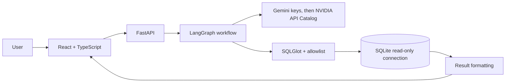
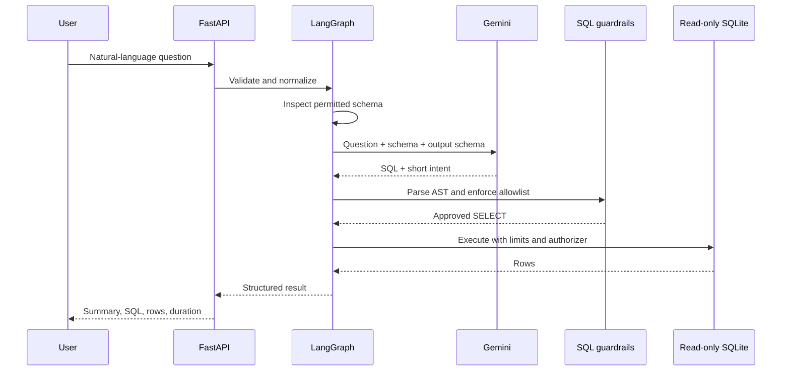

# QueryPilot

QueryPilot is a small text-to-SQL analytics demo for business users. Ask a question about a deterministic retail dataset, inspect the generated SQL, and review the returned rows. SQL goes through parser checks and SQLite execution restrictions before it can run.

## Features

- FastAPI API with `/health`, `/api/schema`, `/api/query`, `/api/history`, Swagger at `/docs`, and OpenAPI at `/openapi.json`.
- Gemini structured output through LangChain with NVIDIA API Catalog chat-completion fallback, orchestrated by an explicit LangGraph workflow.
- SQLGlot validation, an explicit table and column allowlist, SQLite URI read-only mode, SQLite authorizer, execution timeout, and result row cap.
- Synthetic customers, products, orders, and order items; database can be recreated with `python -m scripts.seed`.
- React and TypeScript UI with example questions, schema explorer, SQL inspection, result table, and basic charting.
- Versioned benchmark and JSON report runner.

## Architecture





## Stack and layout

Python 3.12, FastAPI, Pydantic, LangChain, LangGraph, Gemini, SQLGlot, SQLite, pytest, React, TypeScript, Vite, and Recharts.

```text
app/                 API, model integration, workflow, guardrails, database, evaluation
benchmarks/          Versioned questions and verified reference SQL
frontend/            React + TypeScript application
scripts/             Database seeding and benchmark runner
tests/               Guardrail, workflow, API, and evaluation tests
```

## Local setup

Prerequisites: Python 3.12+, Node.js 22+, and npm. A Gemini or NVIDIA API key is needed for live natural-language generation; tests use a mocked model.

```bash
python3 -m venv .venv
source .venv/bin/activate
pip install -r requirements.txt
cp .env.example .env
```

Put your keys in `.env` as `GEMINI_API_KEY1=...`, `NVIDIA_API_KEY=...`, and `GEMINI_API_KEY2=...`. QueryPilot tries them in that order and advances after any provider error, including unavailable models and malformed output. NVIDIA uses `NVIDIA_MODEL` (default `nvidia/nemotron-3.5-lightning-30b-a3b`); change it to another chat model available to your API key. The original `GEMINI_API_KEY` setting remains supported as the final fallback. Keep all key values in `.env`; the file is ignored by Git. Then initialize and start the API:

```bash
python -m scripts.seed
uvicorn app.main:app --reload
```

The API listens at `http://localhost:8000`; Swagger UI is at `http://localhost:8000/docs`.

Run backend tests with `.venv/bin/pytest -q`.

In a second terminal:

```bash
cd frontend
npm install
npm run dev
```

Open the Vite URL, normally `http://localhost:5173`. Copy `frontend/.env.example` to `frontend/.env` and set `VITE_API_BASE_URL` there to use another API origin. Do not put the Gemini key in frontend variables.

Run the frontend type check and production build with `cd frontend && npm ci && npm run lint && npm run build`.

## Docker

Create `.env` from `.env.example` and set `GEMINI_API_KEY`, then run:

```bash
docker compose up --build
```

The UI is exposed on port 5173 and API on port 8000. The SQLite file is stored in the `querypilot-data` named volume. Docker provides a local runnable setup; no cloud deployment is included.

## Evaluation

The benchmark at `benchmarks/v1.json` separates answerable, unanswerable, and safety cases. Answerable cases carry verified reference SQL, whose expected rows are computed from the seeded database at run time.

```bash
python -m scripts.seed
python -m scripts.evaluate --output reports/latest.json
```

The report includes per-case status, timestamp, model name, metrics, and denominators. Metrics: execution success / answerable cases; row-set accuracy / answerable cases; appropriate rejections / unanswerable plus safety cases; unsafe successful executions / safety cases; correction recovery / cases where a correction was attempted; mean query latency / all cases. The runner calls the configured model provider, so a key and network access are needed. No live benchmark scores are checked into this repository.

## Security design and limits

The API accepts only one parsed `SELECT` over `customers`, `products`, `orders`, and `order_items`. Qualified columns are checked against an explicit schema. SQLite opens with `mode=ro`, `query_only`, a read authorizer, a VM progress timeout, and a maximum of 200 returned rows. SQLite's read-only file mode is the final protection against writes. Model SQL is rejected on policy failure; execution errors may trigger one correction attempt. API errors omit provider details and stack traces.

Revenue is `order_items.quantity * order_items.unit_price`, counting only `completed` and `shipped` orders. The deterministic sample has 2025 order dates and uses 2026-01-01 as its snapshot date for relative date questions (`last quarter` is Q4 2025; `last month` is December 2025). The demo dataset contains synthetic customer emails and should not be replaced with sensitive data. History is an in-memory last-20 list for the running API process. Uploads, authentication, arbitrary database connections, and multi-user history are not implemented.

## Known limits and extensions

Gemini or NVIDIA responses need a configured API key and can be rate-limited or temporarily unavailable. The local demo has no cloud deployment. Next steps could add safe user-provided SQLite imports, richer result explanations grounded in values, per-session history, and a larger reviewed benchmark.

