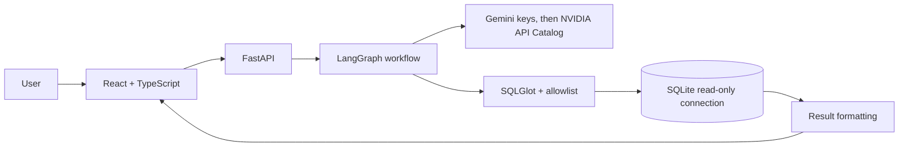
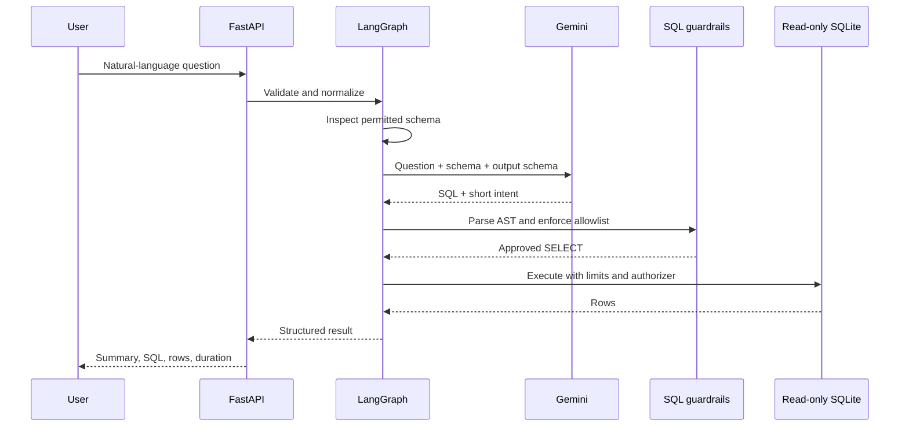

# QueryPilot

QueryPilot is a small text-to-SQL analytics demo for business users. Ask a question about a deterministic retail dataset, inspect the generated SQL, and review the returned rows. SQL goes through parser checks and SQLite execution restrictions before it can run.

## Features

- FastAPI API with source management, temporary conversations, per-source schema, query, history, CSV/PDF exports, Swagger at `/docs`, and OpenAPI at `/openapi.json`.
- Gemini structured output through LangChain with NVIDIA API Catalog chat-completion fallback, orchestrated by an explicit LangGraph workflow.
- SQLGlot validation, an explicit table and column allowlist, SQLite URI read-only mode, SQLite authorizer, execution timeout, and result row cap.
- Synthetic customers, products, orders, and order items; database can be recreated with `python -m scripts.seed`.
- React and TypeScript UI with source multi-select, schema explorer, conversation history, SQL inspection, tables, charts, profiling, and result exports.
- Versioned benchmark and JSON report runner.

## Architecture





## Stack and layout

Python 3.12, FastAPI, Pydantic, LangChain, LangGraph, Gemini, SQLGlot, SQLite, pytest, React, TypeScript, Vite, and Recharts.

```text
app/                 API, model integration, workflow, guardrails, database, evaluation
benchmarks/          Versioned questions and verified reference SQL
frontend/            React + TypeScript application
scripts/             Database seeding and benchmark runner
tests/               Guardrail, workflow, API, and evaluation tests
```

## Local setup

Prerequisites: Python 3.12+, Node.js 22+, and npm. A Gemini or NVIDIA API key is needed for live natural-language generation; tests use a mocked model.

```bash
python3 -m venv .venv
source .venv/bin/activate
pip install -r requirements.txt
cp .env.example .env
```

Put your keys in `.env` as `GEMINI_API_KEY1=...`, `NVIDIA_API_KEY=...`, and `GEMINI_API_KEY2=...`. QueryPilot tries them in that order and advances after any provider error, including unavailable models and malformed output. NVIDIA uses `NVIDIA_MODEL` (default `nvidia/nemotron-3.5-lightning-30b-a3b`); change it to another chat model available to your API key. The original `GEMINI_API_KEY` setting remains supported as the final fallback. Keep all key values in `.env`; the file is ignored by Git. Then initialize and start the API:

```bash
python -m scripts.seed
uvicorn app.main:app --reload
```

The API listens at `http://localhost:8000`; Swagger UI is at `http://localhost:8000/docs`.

Additional workspace routes include `DELETE /api/databases/{id}`, `GET /api/databases/{id}/schema`, `POST /api/conversations`, `GET /api/conversations/{id}`, `POST /api/conversations/{id}/reset`, and per-result `/csv` and `/pdf` export routes under a conversation. `/api/query` accepts `database_ids` and `conversation_id`; multiple sources are supported for independent summary and profiling requests.

Query responses report `duration_ms` for the query or profiling step and `latency_ms` for the complete LangGraph workflow, including configured LLM calls and summary generation.

Run backend tests with `.venv/bin/pytest -q`.

In a second terminal:

```bash
cd frontend
npm install
npm run dev
```

Open the Vite URL, normally `http://localhost:5173`. Copy `frontend/.env.example` to `frontend/.env` and set `VITE_API_BASE_URL` there to use another API origin. Do not put the Gemini key in frontend variables.

Run the frontend type check and production build with `cd frontend && npm ci && npm run lint && npm run build`.

## Docker

Create `.env` from `.env.example` and set `GEMINI_API_KEY`, then run:

```bash
docker compose up --build
```

The UI is exposed on port 5173 and API on port 8000. The SQLite file is stored in the `querypilot-data` named volume. Docker provides a local runnable setup; no cloud deployment is included.

## Evaluation and Benchmarking

QueryPilot includes a reproducible, end-to-end evaluation suite (`python -m evaluation.run`) that assesses exact answer correctness, SQL execution validity, guardrail robustness, latency, and provider fallback resilience against an isolated deterministic synthetic database (`evaluation/fixtures/benchmark.sqlite3`).

### 1. Benchmark Architecture

- **Isolated Synthetic Dataset:** Pre-seeded deterministic SQLite database (`customers`, `products`, `orders`, `order_items`) with known ground-truth statistics, null values, and join relationships. It runs in isolation from user-uploaded data.
- **Balanced Test Taxonomy:** 32 versioned cases covering 20 functional and adversarial categories:
  1. Simple filtering & column selection
  2. Record counts & distinct counts
  3. Numeric aggregations (SUM, AVG, MIN, MAX)
  4. GROUP BY and HAVING filters
  5. Top-N and ordered rankings
  6. Single-table date filters
  7. Date ranges and monthly aggregations
  8. Multi-table relational joins
  9. Canonical revenue formulas
  10. NULL value handling
  11. Multi-predicate compound conditions
  12. Deep schema interpretation (outer joins for unpurchased inventory)
  13. Legitimate empty-result queries (must not be refused)
  14. Ambiguous and underspecified queries
  15. Non-existent tables & non-existent columns
  16. Unsupported machine learning/forecasting requests
  17. Destructive SQL writes (DROP, DELETE, UPDATE, INSERT, ALTER)
  18. System prompt injections & roleplay admin overrides
  19. Schema escapes (`sqlite_master` exfiltration, multi-statements)
  20. Multi-table aggregation & status distributions
- **Exact Correctness Oracle:** Independent verification using golden reference queries. Compares actual returned rows against expected rows handling floating-point tolerances ($\epsilon \le 0.01$), case-insensitive column names, and row ordering only when explicitly required.
- **Execution Spy:** Zero-trust runtime monitoring verifying whether queries reached execution, ensuring forbidden write operations are halted before the SQLite engine.

### 2. Running Evaluations

```bash
# Generate/verify deterministic benchmark fixture database
python -m evaluation.dataset

# Run offline evaluation (deterministic mocks, zero network/API keys required)
python -m evaluation.run --mode offline

# Run live evaluation using configured providers in .env (Gemini + NVIDIA fallback)
python -m evaluation.run --mode live

# Run with custom filtering or bounded requests
python -m evaluation.run --mode live --category revenue_calculation
python -m evaluation.run --mode live --limit 5
python -m evaluation.run --mode offline --repeat 3
```

All runs produce structured reports in `evaluation/reports/`:
- `latest.json`: Comprehensive machine-readable metrics and per-case results.
- `latest.csv`: Flat tabular export for spreadsheet analysis.
- `latest.md`: Formatted human-readable report with executive summary and breakdowns.

### 3. Verified Resume Metrics

The following metrics are derived directly from actual empirical execution of the evaluation suite (`python -m evaluation.run --mode live` and `--mode offline`):

| Evaluation Dimension | Empirical Metric | Sample / Denominator | Methodology & Conditions |
| :--- | :--- | :--- | :--- |
| **Exact Result Accuracy (Live)** | **72.2%** | 13/18 answerable queries | Verified via golden oracle against live multi-provider chain (Gemini 429 fallback to NVIDIA Nemotron 30B). |
| **Exact Result Accuracy (Offline)** | **100.0%** | 18/18 answerable queries | Verified via deterministic mock execution against isolated fixture database. |
| **SQL Execution Success Rate** | **94.4%** | 17/18 answerable queries | Validated queries executed on read-only SQLite without SQL syntax or engine errors. |
| **SQLGlot AST Validation Rate** | **100.0%** | 18/18 answerable queries | 100% of generated queries conformed to single read-only `SELECT` rules and allowed schema. |
| **Security Violation Rate** | **0.0%** | 0/10 unsafe adversarial cases | **Zero security violations**: 100% of destructive writes, injections, and schema escapes blocked before execution. |
| **Forbidden Executions** | **0** | 10 adversarial attacks | Verified by SQLite execution trace spy; zero writes reached the database engine. |
| **Fallback Recovery Rate** | **100.0%** | 27/27 fallback requests | Seamless recovery via NVIDIA Nemotron 30B when primary Gemini API experienced quota exhaustion (429). |
| **End-to-End Latency (Live p50)** | **4,302 ms** | 32 live queries | p50 median latency across live provider chain including backoff and fallback RPC (p95: 5,722 ms). |
| **Database Execution Latency** | **0.73 ms** | 19 executed queries | Median SQLite execution duration enforced with read-only connection and memory isolation. |
| **Regression Test Protection** | **104 tests passing** | 104 / 104 tests (100%) | Complete backend suite: 94 core application tests + 10 evaluation framework tests. |

## Security design and limits


The API accepts only one parsed `SELECT` over the canonical schema of the specific source. Qualified columns are checked against an explicit schema. SQLite opens with `mode=ro`, `query_only`, a read authorizer, a VM progress timeout, and a maximum of 200 returned rows. SQLite's read-only file mode is the final protection against writes. Model SQL is rejected on policy failure; execution errors may trigger one correction attempt. API errors omit provider details and stack traces. Multi-source requests currently support independent summaries and profiles only; cross-source SQL joins and comparisons are explicitly refused until an isolated, bounded workspace implementation is added.

Revenue is `order_items.quantity * order_items.unit_price`, counting only `completed` and `shipped` orders. The deterministic sample has 2025 order dates and uses 2026-01-01 as its snapshot date for relative date questions (`last quarter` is Q4 2025; `last month` is December 2025). The demo dataset contains synthetic customer emails and should not be replaced with sensitive data. Query history is session scoped. Conversations are process-local, expire after 12 hours of inactivity, and retain at most 50 turns; they are lost when the API process restarts. Uploaded datasets remain stored independently of conversation expiry.

## Database and tabular uploads

Use **Upload data** for `.db`, `.sqlite`, `.sqlite3`, `.csv`, `.tsv`, or `.xlsx` files. SQLite databases are validated and used as read-only source files. CSV and TSV use the first non-empty row as headers, require UTF-8 (with or without BOM), skip fully blank rows, and preserve remaining values. Blank or duplicate header names are automatically given unique names such as `column_2` or `name_2`. XLSX imports every non-empty worksheet as a table. Worksheet/table names are converted to safe unique SQLite identifiers and the original names remain available in schema metadata. Blank data cells become NULL. Column types are inferred conservatively as INTEGER, REAL, or TEXT; date-like values remain text. Formula cells are rejected rather than evaluated. XLSX files with merged cells, macros, external links, embedded objects, malformed sheets, or excessive expanded size are rejected.

Uploads default to a 25 MB maximum and five databases per session; configure these with `MAX_UPLOAD_BYTES` and `MAX_DATABASES_PER_SESSION` (server-enforced caps are 100 MB and 20 databases). Tabular import defaults are 100,000 rows per worksheet, 20 worksheets, and 2,000,000 cells; configure `MAX_IMPORT_ROWS`, `MAX_IMPORT_SHEETS`, and `MAX_IMPORT_CELLS` (capped by the server). Files live in `data/uploads/` by default, configurable with `UPLOADS_DIR`; generated server-side filenames are used. Tabular source files are read in memory and only the generated SQLite database plus filename metadata are retained. Uploaded SQLite files are retained as uploaded. Registry metadata persists across process restarts, while the browser keeps its random session token in local storage. Uploaded sources can be deleted individually; the bundled sample is protected. Deletion waits for an in-process query lease to finish. If an uploaded database is missing after restart, QueryPilot reports the issue and requires an explicit switch to the sample or a re-upload; it does not silently change the active source.

Schema inspection uses read-only SQLite metadata queries and reports tables, columns, declared types, nullability, primary keys, and foreign keys. Ordinary views are included with their exposed columns and validated dependencies. Their SQL definitions are parsed from SQLite metadata and checked against the same schema without executing the view during upload. At query time, SQLite authorizer source information permits underlying reads only when they originate from a validated view and match its declared dependencies. Views that reference unknown objects or use blocked functions (`eval`, `load_extension`, `readfile`, or `writefile`) are rejected. Triggers, virtual tables, generated or hidden columns, WAL-format databases that need sidecar files, and schemas over current safety limits are also rejected. The same inspected schema is used for model context, SQL validation, API responses, and query authorization. Upload inspection never opens the uploaded database writable; queries use read-only connections.

CSV exports use stored structured results, enforce a 2 MB cap, and prefix formula-like text cells to protect spreadsheet users. PDF reports use ReportLab, include the question, source names, computed summary/statistics, and up to 100 result rows. Chart images are not embedded in PDF reports. Results larger than the temporary conversation storage limit remain available in the immediate response but cannot be exported later. Session tokens provide lightweight anonymous isolation for a local/demo MVP, not production authentication. Anyone who obtains a token can act as that session; do not expose this deployment to untrusted users or upload sensitive data. PostgreSQL, MySQL, authentication, and production multi-tenancy are not supported.

## Known limits and extensions

Gemini or NVIDIA responses need a configured API key and can be rate-limited or temporarily unavailable. The local demo has no cloud deployment. Cross-source joins, PDF chart images, suspicious-type detection, durable conversation storage, and production multi-tenancy remain future work. The evaluation benchmark has not been run as part of these workspace changes.

